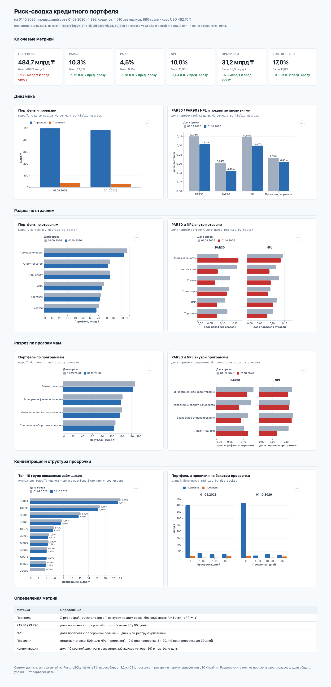

# Риск-сводка кредитного портфеля (тестовый проект arqa BI)

Витрины в PostgreSQL 16 → семантическая модель в YAML → дашборд на Vega-Lite.
Два месячных среза синтетического портфеля: **01.09.2026** и **01.10.2026**.
Задание: <https://jobs.arqa.cc/bi> (раздел «Мини-проект»).

**Живой дашборд: _ссылка добавляется после деплоя_**



Сайт показывает **снимок**, выгруженный из Postgres в `dashboard/data/*.json`;
`make all` пересобирает БД из CSV, прогоняет проверки и перегенерирует эту выгрузку.

> Все числа в этом README подставлены скриптом `scripts/render_readme.py` прямо из
> `reporting.*` (блоки между маркерами `<!-- AUTO:… -->`). Руками не вбивалось ничего.

---

## Как запустить

Нужны **Docker** и **psql** (клиент PostgreSQL). Python — только стандартная библиотека,
`pyyaml` ставится автоматически в локальный `.venv`, если его нет в системе.

```bash
cp .env.example .env     # при необходимости поменяйте порт/пароль
make all                 # БД → схемы → загрузка CSV → вьюхи → проверки → выгрузка JSON → README
make serve               # дашборд на http://localhost:8000
```

`make all` идемпотентен: повторный запуск не ломается и даёт **побайтово** ту же выгрузку
(проверяется скриптом `./scripts/check_idempotency.sh`, который гоняет пайплайн дважды и
сравнивает результат).

| Команда | Что делает |
|---|---|
| `make all` | весь пайплайн одной командой |
| `make profile` | профилирование сырых CSV (список аномалий) |
| `make checks` | только проверки: 7 SQL-ассертов + независимый пересчёт из CSV |
| `make metrics` | показать `reporting.v_portfolio_metrics` |
| `make serve` | статический сервер для дашборда |
| `make screenshot` | пересобрать `docs/dashboard.png` (падает при ошибках в консоли) |
| `make down` | остановить и удалить БД |

## Структура репозитория

```
data/                 portfolio.csv, fx.csv — исходные данные (закоммичены)
sql/raw/              схема raw: DDL (create if not exists) + идемпотентная загрузка \copy
sql/reporting/        вьюхи reporting.v_* (только CREATE OR REPLACE VIEW)
checks/               7 SQL-ассертов + независимый пересчёт на Python из CSV
semantic/portfolio.yml  семантическая модель: измерения и меры над витриной
dashboard/            index.html, specs/*.json (Vega-Lite v5), data/*.json (выгрузка из вьюх)
scripts/              профилирование, выгрузка, валидация модели, скриншот, генерация README
docs/                 data_quality.md, verification.md, ai_log.md, dashboard.png
CLAUDE.md             правила проекта для ИИ-агента (определения, конвенции, правило проверки)
```

Слои витрины:

| Вьюха | Назначение |
|---|---|
| `reporting.v_params` | единственное место с порогами DPD, ставками провизий, размером топа и базовой датой |
| `reporting.v_fx` | курсы к тенге, одна строка на (дата, валюта), плюс синтетический `KZT = 1` |
| `reporting.v_loan_snapshot` | очищенная витрина: 1 строка на (report_date, loan_id), FX, флаги, бакет, провизии |
| `reporting.v_portfolio_metrics` | метрики на каждую дату + изменение к 01.09 (₸ для сумм, п.п. для долей) |
| `reporting.v_metrics_by_sector` / `_by_program` / `_by_dpd_bucket` | те же метрики в разрезах |
| `reporting.v_group_exposure` / `v_top_groups` | экспозиция групп связанных заёмщиков и топ-10 |

## Определения метрик (как в задании)

- **Портфель** — Σ `principal_outstanding`, переведённая в тенге по курсу **на дату среза**,
  **без списанных** (`written_off = 1`).
- **PAR30 / PAR90** — доля портфеля с просрочкой **строго больше** 30 / 90 дней.
- **NPL** — доля портфеля с просрочкой **> 90 дней ИЛИ** `restructured = 1`.
- **Провизии** — остаток × ставка: **50%** для NPL (приоритет), **10%** при просрочке 31–90,
  **1%** при просрочке до 30 дней. Реструктуризация с DPD = 0 получает 50%.
- **Концентрация** — доля **топ-10 групп** `group_id` по KZT-экспозиции внутри даты.
- **Единый знаменатель:** все доли считаются от портфеля **той же даты**.
  В разрезах (отрасль, программа) доли считаются от портфеля **этого разреза**, а вес разреза
  в общем портфеле вынесен в отдельную колонку `share_of_portfolio`.

Интерпретации, которые пришлось зафиксировать самостоятельно:

1. **Списанные остаются в витрине с флагом**, но все денежные колонки у них равны 0
   (`principal_kzt_active`, `par30_kzt`, `par90_kzt`, `npl_kzt`, `provision_kzt`), а метрики
   фильтруют `written_off = 0`. Так объём списаний измерим, но ни одна мера его не включает.
2. **NPL не двойного счёта:** кредит с просрочкой > 90 и реструктуризацией попадает в NPL один раз.
3. **Курс строго на дату среза**, без fallback «последний известный»: на этих данных курсы есть
   на обе даты, а непротестированная ветка в расчёте денег опаснее явной ошибки.
   Если курса не окажется — пайплайн упадёт на `checks/02_fx_coverage.sql`.
4. **Срок погашения не влияет на метрики:** 883 строки с истёкшим `maturity_date` при остатке > 0
   остаются в портфеле (ни одно определение задания не опирается на срок), но помечены флагом
   `is_past_maturity`.

## Качество данных: что нашли и что сделали

Подробно — в [`docs/data_quality.md`](docs/data_quality.md). Коротко:

| Аномалия | Объём | Решение |
|---|---|---|
| Полные дубликаты строк | 60 строк (30 на каждый срез, 59 кредитов) | дедупликация по (report_date, loan_id); без неё портфель завышен на 14,27 млрд ₸ (01.09) и 12,00 млрд ₸ (01.10) |
| Списанные кредиты с остатком > 0 | 34 строки | исключены из портфеля, оставлены в витрине с флагом |
| Реструктуризации с DPD = 0 | 180 строк | это бизнес-правило, а не грязь: NPL + ставка 50% |
| Истёкший срок погашения при остатке > 0 | 883 строки (746 из них с DPD = 0) | не трогаем, помечаем флагом, выносим вопрос владельцу источника |
| **Возврат списаний: `written_off` 1 → 0** | **23 кредита** | правило не меняем (флаг на дату среза), но эффект измерен и вынесен в выводы |

Проверено и **не найдено**: пустых значений, пробелов и регистра в справочниках, опечаток
в отраслях/программах, отрицательных и нулевых остатков, отрицательных DPD, битых дат,
валют без курса, кредитов, присутствующих только в одном срезе, смены атрибутов кредита
между срезами, заёмщиков в нескольких группах.

---

## Итоговые цифры

<!-- AUTO:headline -->
| Показатель | 01.09.2026 | 01.10.2026 | Изменение |
|---|---:|---:|---:|
| Портфель (без списанных) | 498 153 228 694,60 ₸ | 484 674 770 832,95 ₸ | −13,5 млрд ₸ |
| — то же, млрд ₸ | 498,2 | 484,7 | −13,5 |
| PAR30 | 12,05% | 10,33% | −1,72 п.п. |
| PAR90 | 6,24% | 4,46% | −1,78 п.п. |
| NPL | 11,85% | 10,01% | −1,84 п.п. |
| Провизии | 36 512 259 066,41 ₸ | 31 171 241 408,47 ₸ | −5,3 млрд ₸ |
| Покрытие провизиями (провизии / портфель) | 7,33% | 6,43% | −0,90 п.п. |
| Концентрация: топ-10 групп | 17,04% | 17,02% | −0,03 п.п. |
| Кредитов в портфеле | 1 975 | 1 992 | +17 |
| Списано (вне портфеля) | 25 шт. / 6,5 млрд ₸ | 8 шт. / 1,6 млрд ₸ | — |
| Курс USD на дату среза | 478,35 ₸ | 482,10 ₸ | +3,75 ₸ |
| Доля валютного (USD) портфеля | 11,10% | 11,14% | +0,04 п.п. |
<!-- /AUTO:headline -->

### Разрез по отраслям на 01.10.2026

<!-- AUTO:sector -->
| Отрасль | Портфель, млрд ₸ | Доля портфеля | PAR30 | NPL | Провизии, млрд ₸ | Кредитов |
|---|---:|---:|---:|---:|---:|---:|
| Промышленность | 103,6 | 21,37% | 16,45% | 13,53% | 8,9 | 334 |
| Транспорт | 84,8 | 17,50% | 11,75% | 8,42% | 4,8 | 369 |
| Строительство | 82,5 | 17,01% | 8,17% | 8,99% | 4,9 | 314 |
| АПК | 74,3 | 15,33% | 7,95% | 10,37% | 4,8 | 330 |
| Торговля | 71,9 | 14,83% | 7,75% | 8,10% | 3,7 | 303 |
| Услуги | 67,7 | 13,96% | 7,13% | 9,53% | 4,0 | 342 |
<!-- /AUTO:sector -->

### Разрез по программам на 01.10.2026

<!-- AUTO:program -->
| Программа | Портфель, млрд ₸ | Доля портфеля | PAR30 | NPL | Провизии, млрд ₸ | Кредитов |
|---|---:|---:|---:|---:|---:|---:|
| Лизинг техники | 143,9 | 29,69% | 11,78% | 6,80% | 7,3 | 531 |
| Экспортное финансирование | 119,2 | 24,60% | 9,16% | 12,14% | 8,7 | 488 |
| Инвестиционное кредитование | 116,6 | 24,06% | 11,46% | 10,68% | 8,0 | 473 |
| Пополнение оборотных средств | 105,0 | 21,66% | 8,41% | 11,26% | 7,2 | 500 |
<!-- /AUTO:program -->

### Топ-10 групп связанных заёмщиков на 01.10.2026

<!-- AUTO:top_groups -->
| # | Группа | Экспозиция, млрд ₸ | Доля портфеля | Кредитов | Заёмщиков |
|---:|---|---:|---:|---:|---:|
| 1 | G0004 | 21,0 | 4,34% | 9 | 5 |
| 2 | G0001 | 16,3 | 3,36% | 14 | 5 |
| 3 | G0005 | 11,7 | 2,41% | 10 | 6 |
| 4 | G0003 | 7,4 | 1,53% | 7 | 3 |
| 5 | G2277 | 5,5 | 1,14% | 3 | 1 |
| 6 | G2208 | 4,4 | 0,91% | 3 | 1 |
| 7 | G1995 | 4,3 | 0,89% | 5 | 1 |
| 8 | G0002 | 4,0 | 0,83% | 7 | 5 |
| 9 | G0013 | 4,0 | 0,83% | 12 | 5 |
| 10 | G1839 | 3,8 | 0,79% | 5 | 1 |
| | **Итого топ-10** | **82,5** | **17,02%** | | |
<!-- /AUTO:top_groups -->

---

## Три вывода для риск-комитета

### 1. Качество портфеля улучшилось по всем метрикам — и улучшилось бы сильнее, если бы не возврат списаний

NPL снизился с 11,85% до 10,01% (−1,84 п.п.), PAR90 — с 6,24% до 4,46% (−1,78 п.п.).
Разложение изменения NPL по факторам:

<!-- AUTO:npl_bridge -->
| Фактор | Сумма, млрд ₸ |
|---|---:|
| NPL на 01.09.2026 | 59,0 |
| − ушли в списание | −1,1 |
| − вышли из NPL (просрочка закрыта, реструктуризация снята) | −15,3 |
| + новые NPL | +4,5 |
| ± изменение остатков по оставшимся в NPL (амортизация + курс) | +1,3 |
| **NPL на 01.10.2026** | **48,5** |
| *невязка моста* | *0,00 ₸* |
<!-- /AUTO:npl_bridge -->

Основной драйвер — выход кредитов из NPL на 15,29 млрд ₸ при притоке новых на 4,52 млрд ₸.
Но одновременно **23 кредита, числившихся списанными на 01.09, на 01.10 снова в портфеле**.
Списание необратимо, поэтому это либо ошибка источника, либо нестандартное восстановление долга:

<!-- AUTO:comparability -->
| Фактор сопоставимости | Значение |
|---|---:|
| Кредитов с переходом `written_off` 1 → 0 (01.09 → 01.10) | 23 |
| Их остаток в портфеле на 01.10 | 5 675 019 588,05 ₸ (1,17% портфеля) |
| Из них попадает в NPL | 2 960 417 548,60 ₸ |
| Портфель на 01.10 без них (сопоставимая база) | 478 999 751 244,90 ₸ |
| Валютный остаток, USD: 01.09 → 01.10 | 115 563 208,38 → 111 985 713,98 |
| Курс USD: 01.09 → 01.10 | 478,35 → 482,10 ₸ (+0,78%) |
| Курсовой эффект на USD-портфель (переоценка остатка 01.10) | +419 946 427,43 ₸ |
| Фактическое изменение USD-портфеля в ₸ | −1,3 млрд ₸ |
| NPL на 01.10: отчётный → без вернувшихся | 10,01% → **9,51%** (−0,50 п.п.) |
| PAR30 на 01.10: отчётный → без вернувшихся | 10,33% → 9,83% (−0,50 п.п.) |
| PAR90 на 01.10: отчётный → без вернувшихся | 4,46% → 3,90% (−0,57 п.п.) |
<!-- /AUTO:comparability -->

Эффект разнонаправленный и его стоит проговорить точно: вернувшиеся кредиты добавляют
5,68 млрд ₸ к знаменателю и 2,96 млрд ₸ к числителю NPL, и в сумме **ухудшают** отчётный
показатель. Без них NPL на 01.10 составил бы **9,51% вместо 10,01%** (−0,50 п.п.),
PAR90 — 3,90% вместо 4,46%.

**Что делать:** запросить у владельца источника природу перехода `written_off` 1 → 0;
до выяснения считать сопоставимой базой **478 999 751 244,90 ₸** и держать в уме, что
реальное улучшение качества портфеля больше, чем показывает отчёт, а база портфеля
завышена на 1,17%.

### 2. Концентрация стабильна по величине, но сосредоточена в одной группе

Топ-10 групп держат 17,02% портфеля (было 17,04%, изменение −0,03 п.п. — то есть ничего
не изменилось). Однако распределение внутри топа неравномерно: **группа G0004 одна держит
4,34% портфеля** (21,04 млрд ₸ по 9 кредитам пяти заёмщиков) — больше, чем группы с 4-й по 7-е
место вместе взятые. Три крупнейшие группы (G0004, G0001, G0005) дают 10,11% портфеля.

**Что делать:** лимиты на группу связанных заёмщиков имеет смысл обсуждать не по агрегату
топ-10 (он стабилен и выглядит спокойно), а по головной группе: дефолт G0004 в одиночку
переводит в проблемные более 4% портфеля — это больше годового объёма новых списаний.

### 3. Риск сконцентрирован в промышленности и в экспортном финансировании, а курс почти ни при чём

На 01.10 **Промышленность** — крупнейшая отрасль (21,37% портфеля) и одновременно худшая по
качеству: NPL 13,53% и PAR30 16,45% против 10,01% и 10,33% по портфелю. В разрезе программ
худшее качество у **Экспортного финансирования** (NPL 12,14% при 24,60% портфеля), лучшее —
у **Лизинга техники** (NPL 6,80% при самой большой доле 29,69%).

Валютный риск при этом незначителен: USD-портфель — 11,14% портфеля, курс вырос всего на
0,78% (478,35 → 482,10 ₸), и переоценка добавила лишь **+419 946 427,43 ₸** (0,09% портфеля),
тогда как сам валютный портфель сократился на 1,29 млрд ₸ за счёт погашений.

**Что делать:** обсуждать не курсовой риск, а отраслевой лимит на промышленность и пересмотр
условий экспортного финансирования; снижение общего NPL не должно маскировать то, что
в промышленности он остаётся выше 13%.

---

## Как проверялись цифры

Полностью — в [`docs/verification.md`](docs/verification.md). Четыре независимых слоя,
все запускаются в `make all`, пайплайн падает при любом расхождении:

1. **7 SQL-ассертов** (`checks/*.sql`): объёмы и дедупликация (ровно 60 удалённых дублей),
   покрытие курсами, аддитивность (портфель = Σ по отраслям = Σ по программам = Σ по бакетам =
   Σ по группам **до копейки**), инварианты метрик (PAR30 ⊇ PAR90, NPL ⊇ PAR90, доли в [0,1]),
   независимый пересчёт концентрации и провизий, сквозная сверка отдельных кредитов.
2. **Независимый пересчёт вне SQL** (`checks/independent_recompute.py`): читает CSV напрямую
   стандартной библиотекой, написан от определений, не переиспользует логику вьюх,
   сверяет итоги, оба разреза и состав топ-10 с допуском 0,01 ₸ / 1e-9.
3. **Валидация семантической модели** против витрины: колонки существуют, типы мер только
   `sum/avg/count`, а меры, собранные по модели, сходятся с `v_portfolio_metrics`.
4. **Идемпотентность**: два полных прогона дают одинаковые sha256 выгрузки.

Отдельно проверялось, что **проверки умеют падать**: в витрину вносились ошибки
(порог `>30` → `>=30`, join курса на день раньше, снятый приоритет NPL, лишняя строка в raw) —
каждая была поймана, с текстом ошибки в `docs/verification.md`.

## Где ИИ-агент ошибался

Честный журнал — [`docs/ai_log.md`](docs/ai_log.md). Самое важное:

- **Профиль данных смотрел только внутрь среза** и пропустил возврат 23 списанных кредитов
  (5,68 млрд ₸). Нашлось не проверкой, а разбором результата: списанных стало 25 → 8, хотя
  они должны накапливаться. Добавлен блок профилирования переходов флагов между срезами.
- **`DROP TABLE` ломал второй прогон** пайплайна — идемпотентность была заявлена, но не работала;
  поймал скрипт двойного прогона.
- **Спеки Vega-Lite рендерились пустыми**: временной формат на строковом поле и
  `width: "container"` в фасетных спеках. Теперь скриншот падает при любой ошибке в консоли.
- **Диагностический SQL соврал про дубли в витрине**: кейс-запрос выбрал один кредит дважды и
  размножил строки на join.
